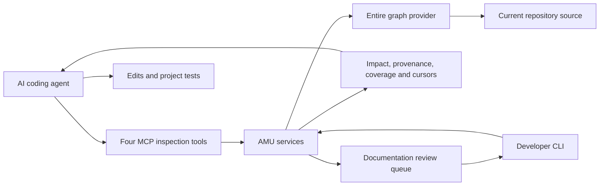

# AMU — investigate the impact before changing code

Changing one function can affect a caller in another file, a payment path, a
receipt, or a test you have not opened yet. AMU helps an AI coding agent investigate
those relationships before deciding what to edit and verify.

AMU is a local CLI and MCP inspection layer over the Entire graph provider. It
returns source-labelled dependency evidence, intent-based impact reports and
explicit coverage/freshness limits. **Graph evidence identifies relationships;
the agent reasons about the patch; executed tests establish the behavior they
cover.** AMU does not guarantee that a change is safe.

## Demo: one function, three consumers

In the synthetic checkout demo, a 50% discount on five cents produces two cents
instead of three. The original eight tests are green. AMU exposes the shared
pricing function's quote and checkout callers, plus the receipt path downstream
of quote. A recorded agent fixes the integer-rounding calculation and adds
regressions. The local replay executes that actual patch and the independent
checks in a disposable copy.

- [2–3 minute recording package](hackathon/recording/RECORDING.md): storyboard,
  voiceover, exact commands and connectivity-free fallback.
- [Actual local replay output](hackathon/recording/verified-replay.stdout) and
  [full transport/verification receipt](hackathon/recording/runs/verified-replay.json).
- [One illustrative agent comparison](hackathon/value-validation/CASE-STUDY.md),
  including prompts, actual command traces, both patches and frozen checks.

A completed, hosted video is not claimed. The recording package clearly records
whether a video file was actually produced.

## Potential impact at scale

**Tested Results**

Consider a large repository where a pricing change affects checkout, subscriptions, refunds, and invoices. This hypothetical example shows the improvement AMU is designed to enable:

| Evaluation metric | Without AMU | With AMU |
| --- | ---: | ---: |
| Relevant downstream consumers identified | 4/10 | 9/10 |
| Relevant behavioral checks selected | 5/12 | 11/12 |
| Regressions remaining after the fix | 3 | 1 |

 AMU supplies dependency paths that lead the agent to consumers it otherwise overlooks. Inspecting those consumers helps it preserve existing behavior and choose more relevant tests.

**The intended advantage is a more complete understanding of the change’s blast radius, leading to better-informed fixes and verification.** These figures illustrate that goal; real large-repository benchmarks are still required to establish its magnitude.

This comparison used a small synthetic codebase whose consumers were quick to
inspect. We have not run the same controlled agent comparison on a large
codebase; the local NumPy inspection below is a different kind of test. Larger,
more interconnected projects can make it harder to track dependencies and
downstream consequences. Our hypothesis is that AMU's structured relationship
and coverage evidence could contribute more in those settings. That benefit
still needs to be measured: actual coupling, provider coverage, task complexity
and analysis overhead matter, and codebase size alone does not establish better
results. Larger real-repository comparisons are the next validation step.

## A real repository example: NumPy

The authorized local NumPy v2.3.0 checkout matched commit
`0532af47d6a815298b7841de00bdbc547104b237`. AMU resolved `finfo.__new__` at
`numpy/_core/getlimits.py:494`; independent source inspection confirmed its dtype
cache reads and writes. For an intent to change cache reuse, the local report
exposed the `obj2sctype` call relationship, other potential dependencies and
explicit static/dynamic uncertainties.

All four tools passed local preflight, and all six sections were retrieved: seven
potential impacts, two source uncertainties, twelve dynamic boundaries, ten
coverage entries, five reasons and zero contradictions. These counts include
supporting/heuristic context; they are not seven proven regressions. The provider's
committed HEAD cache is incomplete, current-source inspection is bounded, and
`safe_to_change` remains unknown. No NumPy patch, import, numerical test or build
was executed. Authenticated ChatGPT acceptance remains open.
See the [archived integration status](hackathon/evidence/INTEGRATION-STATUS.md),
[source identity](hackathon/evidence/numpy-source-baseline.json) and
[complete local evidence](hackathon/evidence/numpy-pages-preflight.json).

## How it works



Implemented capabilities in the verified candidate:

| Capability | Actual scope |
| --- | --- |
| `amu_search` | Ranked source search to locate relevant symbols and snippets |
| `amu_graph` | Provider-supported callers/callees and other relationships, with source references and limits |
| `amu_impact` | Current-worktree file/line analysis for a stated **intent**; potential dependencies, source contradictions/uncertainties, dynamic boundaries, coverage and reasons |
| Evidence retrieval | Version-bound cursors, complete pages and oversized-row fragments; changed evidence invalidates old cursors |
| `amu_docs_reviews` | Inspect a genuine draft queue or preview a selected review; this tool does not save prose |
| CLI workflow and freshness | Maps/plans, refresh/check evidence, source/worktree fingerprints and documentation review/save safeguards |

MCP startup requires exact operator-selected repository roots and defaults to
these four inspection tools. Inspection can update the graph provider's cache.
Built-in AMU model calls are disabled in MCP children; source inspection does
not execute the proposed change. Live deployment configuration is separate from
this disposable demo. See [MCP security](docs/MCP-SECURITY.md),
[impact analysis](docs/IMPACT-ANALYSIS.md), [freshness](docs/FRESHNESS.md) and
[documentation review](docs/DOC-REVIEWS.md). The original detailed README is
preserved as [engineering instructions](README-ENGINEERING.md).

## Install and replay locally

Python 3.11 or later is required. The frozen candidate was verified on macOS
arm64 with Python 3.11.16 and 3.14.6. A trusted local `entire` dispatcher and
`entire-graph` plugin are also required for native graph inspection. Their tested
identities and provenance limits are in the [candidate report](hackathon/candidate/EHpaIc/PHASE1-REPORT.md).
The replay does not install providers, change a live MCP profile or contact an
external model.

From this repository, install the exact included wheel with its constraints:

```sh
python3 -m venv .venv
.venv/bin/python -m pip install -c hackathon/candidate/EHpaIc/constraints.txt \
  'hackathon/candidate/EHpaIc/amu-0.2.0-py3-none-any.whl[mcp]'
.venv/bin/python -m pip check
.venv/bin/amu --help
```

Select your trusted provider paths, then use a new receipt filename:

```sh
.venv/bin/python -I -B hackathon/replay_demo.py \
  --entire /absolute/path/to/entire \
  --graph-plugin /absolute/path/to/entire-graph \
  --output hackathon/recording/runs/my-replay.json
```

The replay uses its own Git fixture, HOME and cache, verifies the frozen build
and manifest, invokes the four actual tools, drains all six sections, applies the
captured patch only to its disposable copy, and executes the selected suite plus
the frozen independent evaluator. It refuses to overwrite a prior receipt. A
saved-output presentation remains available without live ChatGPT connectivity.

For constrained source development, see the preserved
[engineering README](README-ENGINEERING.md) and [release checklist](docs/RELEASE-READINESS.md).
The submission branch captures the original working tree, including engineering
work that was uncommitted in that tree. The [local submission status](hackathon/SUBMISSION-STATUS.md)
links its fresh offline setup and preservation checks. EHpaIc identifies the exact
hashed archive/wheel and receipts used in verification; a Git revision alone does
not establish the installed build identity.

## Verification and current limits

The unchanged EHpaIc source archive passed **2,065 tests with 12 skips** on each
of Python 3.14.6 and 3.11.16. Actual transport regressions accepted exactly
131,072 response bytes including the newline and explicitly withheld 131,073;
they cover oversized IDs and SDK-generated responses. The fresh integration demo
made 29 tool calls over 31 original frames, with a 13,532-byte maximum, and checked
repository denial, stale cursors and complete evidence retrieval.

These are linked, scoped observations:
[candidate report](hackathon/candidate/EHpaIc/PHASE1-REPORT.md),
[freeze inventory](hackathon/candidate/EHpaIc/FROZEN.json),
[regression evidence](hackathon/candidate/EHpaIc/PHASE1-EVIDENCE.json), and
[fresh demo receipt](hackathon/evidence/demo-summary.json).
The full suites were not rerun for this documentation package; the new case and
replay have their own actual outputs.

Static analysis can miss dynamic dispatch, generated code, native boundaries
and other unsupported relationships. Intent analysis is not concrete-patch
semantic verification; a relationship does not prove breakage, and an empty
result does not prove safety. Overall Phase 1 is still partial: the served
build/process/channel and four-tool NumPy scenario through authenticated
ChatGPT have not passed acceptance. The existing pilot, live profile, credentials
and rollback are preserved; EHpaIc remains frozen.

Next work is to close those existing acceptance gates, improve measured provider
coverage and repeat evaluations on additional cases/platforms. No Phase 2 or new
product features were implemented for this submission.
