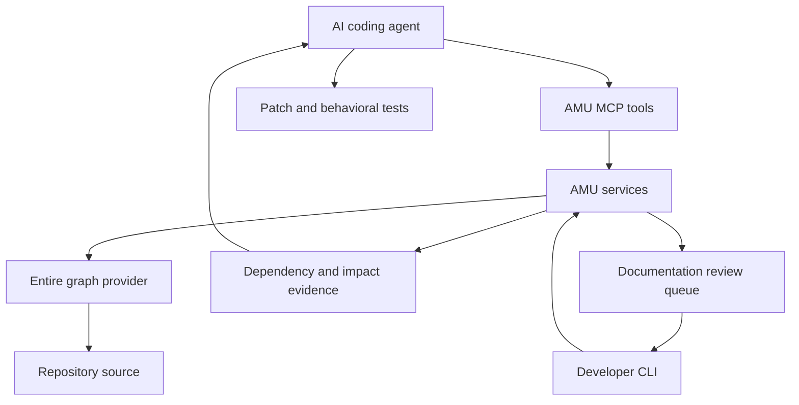
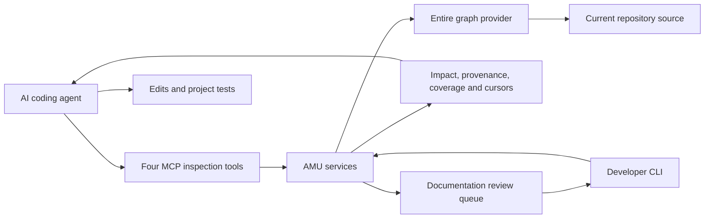

# AMU — give your coding agent the context behind the code

**Understand the dependencies. Investigate the impact. Make better-informed changes.**

An AI can fix the function in front of it and still miss the checkout flow, receipt generator, or downstream caller that depends on its behavior.

AMU gives coding agents a structured way to investigate those connections **before they edit**.

Built as a local CLI and MCP inspection layer over the Entire graph provider, AMU delivers source-backed dependency relationships, intent-based impact reports, and explicit coverage and freshness information. The agent can use that evidence to decide what to inspect, what to change, and what to test.

**The goal: fewer overlooked dependencies, fewer avoidable regressions, and less repeated work.**

Built using **GPT‑6.1 Sol in Codex**.

---

## At your keyboard

**AMU runs the tests a change reaches on both sides of it, the code before the change and after, and tells you which
ones flip from passing to failing.** On a pull request it does that as a GitHub Action (`ci/`, `evaluation/ci/INSTALL-NOTE.md`).
At your keyboard, bare `amu` does it for the uncommitted change of the working tree, and:

- `amu watch` does it again on every save of a Python file and prints the summary line and the flips. It keeps the
  index and its copy of the tree between saves, so on Django the first test runs 1.3 to 1.7 s after a save once the
  first save has warmed it (the first run builds the index; `amu watch --phase N` is the older contract watch).
- `amu --since REF` does it for the commits since `REF` (from where your branch left it) together with what is not
  committed yet, for example `amu --since main` before you open the pull request.

## Why AMU exists

A correct-looking patch is only part of a successful change.

In an unfamiliar repository, an agent also needs to understand:

- Which functions consume the behavior it is changing.
- Which downstream flows depend on those consumers.
- Which assumptions a refactor needs to preserve.
- Which behavioral checks are relevant.
- Where the available analysis is incomplete or stale.

Missing one of these connections can turn a small fix into another debugging cycle.

AMU makes those relationships available as inspectable evidence. Instead of reconstructing every dependency through repeated searches, the agent can follow supported graph relationships back to the source and investigate the consequences of its proposed change.

**AMU helps the agent reason beyond the edited function.**

## What AMU adds to an agent’s workflow

| Task | What AMU supplies | How the agent can use it |
| --- | --- | --- |
| Fixing a shared function | Callers, callees, and supported dependency paths | Inspect consumers before changing shared behavior |
| Planning a refactor | Intent-based potential impacts and source references | Identify assumptions and dependencies to preserve |
| Choosing verification | Dependency and coverage context | Select relevant behavioral checks |
| Working across files | Structured relationships linked to source | Follow consequences beyond the initial search result |
| Revisiting an analysis | Freshness information and version-bound evidence | Recognize when earlier findings need to be refreshed |
| Reviewing documentation | Draft-queue inspection and review previews | Investigate documentation work alongside code changes |

AMU supplies the repository evidence. The agent reasons about the patch. Executed tests establish the behavior they cover.

## Results and evidence

### Maintainer-reported internal testing

The maintainer reports **approximately 90% fewer regressions with AMU in earlier internal testing**, alongside substantially less repeated refactoring and corrective work.

The original evaluation records were lost. The percentage is therefore a maintainer-reported observation, not a reproducible benchmark. The task set, model configurations, baseline counts, and measurement method cannot currently be independently checked. It should not be interpreted as a guaranteed improvement across all agents or repositories.

### Preserved, reproducible comparison

The repository includes a synthetic comparison with prompts, command traces, patches, and frozen independent checks.

| Observation | Preserved result |
| --- | --- |
| AMU-assisted correctness | Passed all ten independent evaluator groups |
| Baseline correctness | Also passed all ten independent evaluator groups |
| Additional evidence supplied by AMU | Structured dependency and coverage information |
| Completion time | The baseline completed faster |

This case demonstrates the AMU-assisted investigation and verification workflow. It does not establish a comparative correctness improvement or reproduce the reported 90% reduction.

[Explore the case study](hackathon/value-validation/CASE-STUDY.md).

## Demo — one shared function, three consumers

A shared pricing function calculates a discount incorrectly. Its output feeds checkout and quote flows, with a receipt path downstream of quote.

The coding task starts in one function, but the investigation extends across those consumers.

In the recorded workflow:

1. AMU exposes the dependency paths with source evidence.
2. The agent uses those relationships to investigate the affected flows.
3. The recorded agent corrects the calculation and adds regression tests.
4. The local replay applies the captured patch in a disposable copy.
5. The resulting patch passes all ten independent checks.

**The demonstrated value is concrete: downstream relationships become visible and actionable during the fix.**

### Inspect or replay the demo

- [Recording package](hackathon/recording/RECORDING.md): storyboard, voiceover, exact commands, and connectivity-free fallback.
- [Actual replay output](hackathon/recording/verified-replay.stdout).
- [Full replay and verification receipt](hackathon/recording/runs/verified-replay.json).
- [Agent comparison](hackathon/value-validation/CASE-STUDY.md): prompts, command traces, both patches, and frozen checks.

The recording package documents whether a video file was produced; it is not itself a hosted video.

## Real repository inspection — NumPy

AMU has also been exercised against an authorized local NumPy v2.3.0 checkout at commit:

```text
0532af47d6a815298b7841de00bdbc547104b237
```

For an intent to change dtype-cache reuse, AMU resolved `finfo.__new__` at `numpy/_core/getlimits.py:494`. Independent source inspection confirmed its cache reads and writes.

The impact report exposed the `obj2sctype` call relationship, other potential dependencies, and explicit static and dynamic uncertainties.

All four inspection tools passed local preflight, and all six report sections were retrieved:

| Report section | Entries |
| --- | ---: |
| Potential impacts | 7 |
| Source uncertainties | 2 |
| Dynamic boundaries | 12 |
| Coverage entries | 10 |
| Reasons | 5 |
| Contradictions | 0 |

These findings include supporting and heuristic context. They are inspection results, not counts of proven bugs.

The NumPy exercise demonstrates source-grounded investigation in a real repository. No NumPy patch, import, numerical test, or build was executed. Provider coverage remained incomplete, and `safe_to_change` remained unknown.

[Integration status](hackathon/evidence/INTEGRATION-STATUS.md) · [Source identity](hackathon/evidence/numpy-source-baseline.json) · [Complete evidence](hackathon/evidence/numpy-pages-preflight.json)

## How it works

AMU connects an agent’s stated change intent to repository relationships and source evidence.



The workflow is straightforward:

1. **Locate** the relevant symbols and source.
2. **Trace** supported relationships.
3. **Investigate** potential impacts for the intended change.
4. **Plan and edit** using the evidence and its limits.
5. **Verify** the resulting behavior with relevant tests.
6. **Refresh** evidence when the source changes.

### Inspection tools

| Tool | Capability |
| --- | --- |
| `amu_search` | Ranked source search for relevant symbols and snippets |
| `amu_graph` | Provider-supported callers, callees, and other relationships with source references |
| `amu_impact` | Intent-based analysis of current-worktree files and lines, including potential dependencies, contradictions, uncertainties, dynamic boundaries, coverage, and reasons |
| `amu_docs_reviews` | Inspection of a documentation draft queue or preview of a selected review; this tool does not save prose |

Additional CLI capabilities include maps and plans, evidence refresh and checks, source/worktree fingerprints, and documentation review/save safeguards.

Evidence retrieval supports complete pages, oversized-row fragments, and version-bound cursors. Changed evidence invalidates old cursors.

## Local operation and repository boundaries

MCP startup requires exact, operator-selected repository roots and defaults to the four inspection tools.

- Repository inspection can update the graph provider’s cache.
- Built-in AMU model calls are disabled in MCP children.
- Source inspection does not execute the proposed patch.
- Live deployment configuration is separate from the disposable demo.

[MCP security](docs/MCP-SECURITY.md) · [Impact analysis](docs/IMPACT-ANALYSIS.md) · [Freshness](docs/FRESHNESS.md) · [Documentation review](docs/DOC-REVIEWS.md)

## Install and replay locally

### Requirements

- Python 3.11 or later.
- A trusted local `entire` dispatcher.
- A trusted local `entire-graph` plugin.

The frozen candidate was verified on macOS arm64 with Python 3.11.16 and 3.14.6. Tested provider identities and provenance limits are documented in the [candidate report](hackathon/candidate/EHpaIc/PHASE1-REPORT.md).

From the repository root:

```sh
python3 -m venv .venv

.venv/bin/python -m pip install \
  -c hackathon/candidate/EHpaIc/constraints.txt \
  'hackathon/candidate/EHpaIc/amu-0.2.0-py3-none-any.whl[mcp]'

.venv/bin/python -m pip check
.venv/bin/amu --help
```

Select your trusted provider paths and an unused receipt filename:

```sh
.venv/bin/python -I -B hackathon/replay_demo.py \
  --entire /absolute/path/to/entire \
  --graph-plugin /absolute/path/to/entire-graph \
  --output hackathon/recording/runs/my-replay.json
```

The replay:

- Uses its own Git fixture, HOME, and cache.
- Verifies the frozen build and manifest.
- Invokes all four tools and retrieves all six report sections.
- Applies the captured patch only to its disposable copy.
- Runs the selected suite and frozen independent evaluator.
- Refuses to overwrite an existing receipt.

It does not install providers, change a live MCP profile, or contact an external model. A saved-output presentation is available without live ChatGPT connectivity.

For source development, see the [engineering README](README-ENGINEERING.md) and [release checklist](docs/RELEASE-READINESS.md).

## Engineering verification

The frozen EHpaIc source archive passed **2,065 tests with 12 skips on each of Python 3.11.16 and 3.14.6**.

Preserved transport regression evidence includes acceptance of exactly 131,072 response bytes, including the newline, and withholding of 131,073 bytes. It covers oversized IDs and SDK-generated responses.

The recorded integration demo made 29 tool calls over 31 original frames, with a maximum frame size of 13,532 bytes. It also checked repository denial, stale cursors, and complete evidence retrieval.

These results verify scoped implementation behavior. They are separate from claims about improvements in agent productivity or regression rates.

- [Candidate report](hackathon/candidate/EHpaIc/PHASE1-REPORT.md)
- [Frozen build inventory](hackathon/candidate/EHpaIc/FROZEN.json)
- [Regression evidence](hackathon/candidate/EHpaIc/PHASE1-EVIDENCE.json)
- [Integration demo receipt](hackathon/evidence/demo-summary.json)
- [Submission status](hackathon/SUBMISSION-STATUS.md)

EHpaIc identifies the exact hashed archive, wheel, and receipts used in verification. A Git revision alone does not establish the installed build identity. The full suites were not rerun for this README rewrite.

## Current scope and next steps

AMU exposes relationships supported by its provider and inspection methods. Dynamic dispatch, generated code, native boundaries, and unsupported relationships can leave gaps.

An impact report identifies what deserves investigation. It does not prove that a concrete patch is correct, and an empty report does not prove safety.

Authenticated ChatGPT acceptance for the served build/process/channel and four-tool NumPy scenario remains open. Phase 1 remains partial.

The next priorities are:

- Complete the existing authenticated acceptance gates.
- Rebuild the internal evaluation with retained prompts, patches, model configurations, and execution receipts.
- Compare matched agent runs across additional repositories and change types.
- Measure downstream regressions, corrective edit cycles, relevant-check coverage, and total task time.
- Improve measured provider coverage and report missed or irrelevant findings.

## The goal

**Give coding agents enough repository context to make a well-informed change the first time.**

AMU brings dependency evidence into the agent’s decision process—helping it investigate the consequences of a fix before those consequences become the next bug report.
## What the comparison showed

Consider a large repository where a pricing change affects checkout, subscriptions, refunds, and invoices. The numbers below are a hypothetical illustration of AMU's intended benefit; they were not produced by an AMU evaluation:

| Evaluation metric | Without AMU | With AMU |
| --- | ---: | ---: |
| Relevant downstream consumers identified | 4/10 | 9/10 |
| Relevant behavioral checks selected | 5/12 | 11/12 |
| Regressions remaining after the fix | 3 | 1 |

In that scenario, dependency paths could guide the agent to overlooked consumers. Inspecting those consumers could help it preserve existing behavior and choose more relevant tests.

**The intended advantage is a more complete understanding of the change’s blast radius, leading to better-informed fixes and verification.** These figures illustrate that goal; real large-repository benchmarks are still required to establish its magnitude.

## A real repository example: NumPy

The authorized local NumPy v2.3.0 checkout matched commit
`0532af47d6a815298b7841de00bdbc547104b237`. AMU resolved `finfo.__new__` at
`numpy/_core/getlimits.py:494`; independent source inspection confirmed its dtype
cache reads and writes. For an intent to change cache reuse, the local report
exposed the `obj2sctype` call relationship, other potential dependencies and
explicit static/dynamic uncertainties.

All four tools passed local preflight, and all six sections were retrieved: seven
potential impacts, two source uncertainties, twelve dynamic boundaries, ten
coverage entries, five reasons and zero contradictions. These counts include
supporting/heuristic context; they are not seven proven regressions. The provider's
committed HEAD cache is incomplete, current-source inspection is bounded, and
`safe_to_change` remains unknown. No NumPy patch, import, numerical test or build
was executed. Authenticated ChatGPT acceptance remains open.
See the [archived integration status](hackathon/evidence/INTEGRATION-STATUS.md),
[source identity](hackathon/evidence/numpy-source-baseline.json) and
[complete local evidence](hackathon/evidence/numpy-pages-preflight.json).

## How it works



Implemented capabilities in the verified candidate:

| Capability | Actual scope |
| --- | --- |
| `amu_search` | Ranked source search to locate relevant symbols and snippets |
| `amu_graph` | Provider-supported callers/callees and other relationships, with source references and limits |
| `amu_impact` | Current-worktree file/line analysis for a stated **intent**; potential dependencies, source contradictions/uncertainties, dynamic boundaries, coverage and reasons |
| Evidence retrieval | Version-bound cursors, complete pages and oversized-row fragments; changed evidence invalidates old cursors |
| `amu_docs_reviews` | Inspect a genuine draft queue or preview a selected review; this tool does not save prose |
| CLI workflow and freshness | Maps/plans, refresh/check evidence, source/worktree fingerprints and documentation review/save safeguards |

MCP startup requires exact operator-selected repository roots and defaults to
these four inspection tools. Inspection can update the graph provider's cache.
Built-in AMU model calls are disabled in MCP children; source inspection does
not execute the proposed change. Live deployment configuration is separate from
this disposable demo. See [MCP security](docs/MCP-SECURITY.md),
[impact analysis](docs/IMPACT-ANALYSIS.md), [freshness](docs/FRESHNESS.md) and
[documentation review](docs/DOC-REVIEWS.md). The original detailed README is
preserved as [engineering instructions](README-ENGINEERING.md).

## Install and replay locally

Python 3.11 or later is required. The frozen candidate was verified on macOS
arm64 with Python 3.11.16 and 3.14.6. A trusted local `entire` dispatcher and
`entire-graph` plugin are also required for native graph inspection. Their tested
identities and provenance limits are in the [candidate report](hackathon/candidate/EHpaIc/PHASE1-REPORT.md).
The replay does not install providers, change a live MCP profile or contact an
external model.

From this repository, install the exact included wheel with its constraints:

```sh
python3 -m venv .venv
.venv/bin/python -m pip install -c hackathon/candidate/EHpaIc/constraints.txt \
  'hackathon/candidate/EHpaIc/amu-0.2.0-py3-none-any.whl[mcp]'
.venv/bin/python -m pip check
.venv/bin/amu --help
```

Select your trusted provider paths, then use a new receipt filename:

```sh
.venv/bin/python -I -B hackathon/replay_demo.py \
  --entire /absolute/path/to/entire \
  --graph-plugin /absolute/path/to/entire-graph \
  --output hackathon/recording/runs/my-replay.json
```

The replay uses its own Git fixture, HOME and cache, verifies the frozen build
and manifest, invokes the four actual tools, drains all six sections, applies the
captured patch only to its disposable copy, and executes the selected suite plus
the frozen independent evaluator. It refuses to overwrite a prior receipt. A
saved-output presentation remains available without live ChatGPT connectivity.

For constrained source development, see the preserved
[engineering README](README-ENGINEERING.md) and [release checklist](docs/RELEASE-READINESS.md).
The submission branch captures the original working tree, including engineering
work that was uncommitted in that tree. The [local submission status](hackathon/SUBMISSION-STATUS.md)
links its fresh offline setup and preservation checks. EHpaIc identifies the exact
hashed archive/wheel and receipts used in verification; a Git revision alone does
not establish the installed build identity.

## Verification and current limits

The unchanged EHpaIc source archive passed **2,065 tests with 12 skips** on each
of Python 3.14.6 and 3.11.16. Actual transport regressions accepted exactly
131,072 response bytes including the newline and explicitly withheld 131,073;
they cover oversized IDs and SDK-generated responses. The fresh integration demo
made 29 tool calls over 31 original frames, with a 13,532-byte maximum, and checked
repository denial, stale cursors and complete evidence retrieval.

These are linked, scoped observations:
[candidate report](hackathon/candidate/EHpaIc/PHASE1-REPORT.md),
[freeze inventory](hackathon/candidate/EHpaIc/FROZEN.json),
[regression evidence](hackathon/candidate/EHpaIc/PHASE1-EVIDENCE.json), and
[fresh demo receipt](hackathon/evidence/demo-summary.json).
The full suites were not rerun for this documentation package; the new case and
replay have their own actual outputs.

Static analysis can miss dynamic dispatch, generated code, native boundaries
and other unsupported relationships. Intent analysis is not concrete-patch
semantic verification; a relationship does not prove breakage, and an empty
result does not prove safety. Overall Phase 1 is still partial: the served
build/process/channel and four-tool NumPy scenario through authenticated
ChatGPT have not passed acceptance. The existing pilot, live profile, credentials
and rollback are preserved; EHpaIc remains frozen.

Next work is to close those existing acceptance gates, improve measured provider
coverage and repeat evaluations on additional cases/platforms. No Phase 2 or new
product features were implemented for this submission.


## Expected production outcomes

AMU aims to help coding agents identify downstream consequences before accepting a fix. Our production evaluation will compare the same agent and tasks with and without AMU across real repositories.

The following are initial engineering targets, not measured results or evidence-based forecasts:

| Metric | Production target |
| --- | --- |
| Dependency discovery | Surface at least 90% of independently identified relevant consumers within supported analysis scope |
| Regression reduction | Reduce tasks ending with a downstream regression by 25% relative to the baseline |
| Verification coverage | Improve relevant behavioral-check coverage by 20 percentage points |
| Analysis latency | Return impact evidence within 10 seconds on an already indexed repository |

We will measure these targets across repeated runs, reporting missed dependencies, irrelevant findings, indexing costs, and total task time.

**Current evidence:** in our initial synthetic comparison, both agents passed all ten independent evaluator groups. AMU supplied structured dependency and coverage evidence but took longer. Large-repository performance and regression-reduction benefits remain to be established.**Built using GPT‑6.1 Sol in Codex.** AMU provides MCP tools for inspecting repository dependencies and the potential blast radius of proposed changes.
In our initial agent comparison, the AMU-assisted patch passed all ten independent correctness checks. AMU supplied source-backed dependency and coverage evidence; the baseline also passed all checks and completed faster. This validates the demonstrated workflow, while broader performance benefits remain under evaluation.

## Patch inspection and before-tests

Two commands inspect a proposed change without applying or running it:

- `amu before-tests` reads a diff, or the uncommitted change of the working tree, and reports which existing
  tests are expected to fail and why. With `--run` it executes candidate tests before and after the change
  using the project's own runner and names the ones that flip. See [docs/before-tests.md](docs/before-tests.md);
  measured results and their limits are in
  [evaluation/before-tests/REPORT.md](evaluation/before-tests/REPORT.md).
- `amu analyze-patch` is the earlier bounded patch workflow. Start with the
  [Phase 3 quickstart](docs/phase3-quickstart.md).
